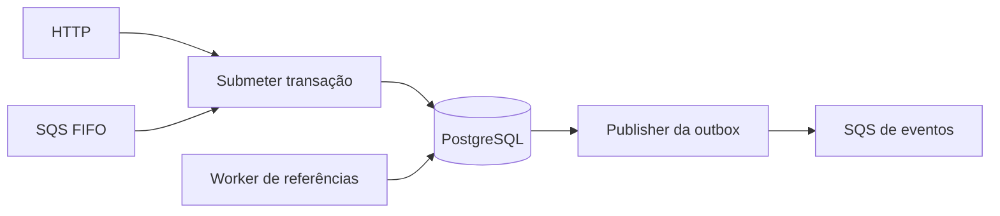

# Arquitetura — Distributed Wagering Processor

## Decisão

Monólito modular com três ou mais instâncias e PostgreSQL como fronteira de consistência. Wallet, transação, ledger, inbox e outbox compartilham o commit, com concorrência por carteira. HTTP e SQS usam o mesmo caso de uso. [Enunciado oficial](https://github.com/junglegaming/backend-challenge/blob/c7143e6d041585d6913f56eb7415105e074f83dc/README.md)

| Escolha | Ganho | Custo |
|---|---|---|
| Lock pessimista por wallet | Cada decisão lê o saldo do último commit. Wallets distintas avançam em paralelo. | Uma wallet muito disputada serializa as operações e pode atingir o timeout. |
| Saldo materializado e ledger append-only | Leitura barata e trilha auditável, com reconciliação independente. | Mais escritas e armazenamento a cada movimento. |
| Inbox/outbox persistentes | Redelivery seguro e recuperação entre commit, publicação e ACK. | Polling, retenção e possibilidade de entrega duplicada do evento. |
| Um código implantado em várias réplicas | A mesma política financeira vale para HTTP, fila e reprocessamento. | API e workers disputam os recursos de cada réplica. O banco é a dependência central. |
| MikroORM com SQL explícito nos pontos críticos | Entidade da wallet, transações e migrations pelo ORM. Locks, constraints, UPSERT e leases são auditáveis no SQL. | Parte da persistência depende de PostgreSQL. No Compose, a aplicação compartilha o papel de schema com o setup; em produção, separe os papéis de migration e runtime. |

Lock otimista exigiria recalcular o efeito após conflitos numa wallet disputada. Um débito condicional também é viável, mas ainda seria preciso coordenar referências, versões, reversões e ledger. A escolha de `FOR UPDATE` por carteira torna essa sequência explícita. [Transações MikroORM](https://mikro-orm.io/docs/transactions) · [Locks PostgreSQL](https://www.postgresql.org/docs/current/sql-select.html)

## Caminho financeiro

1. Validar contratos e produzir SHA-256 de JSON canônico. A lista de campos vem do schema do comando. As chaves são ordenadas recursivamente, UUIDs são normalizados e metadados e chave de idempotência ficam fora do hash do comando. O hash da inbox incorpora a chave de idempotência.
2. Se houver mensagem, reservar a chave da inbox. Uma colisão espera o commit concorrente e confere o hash. O mesmo `messageId` com conteúdo diferente vai à DLQ.
3. Consultar as duas identidades de negócio e devolver o snapshot se ambas apontam para a mesma operação e o hash coincide. Reusar a chave com outro ID externo, alterar a chave de um ID externo ou cruzar as duas identidades é conflito. A inserção `ON CONFLICT DO NOTHING` e uma nova leitura tratam a corrida.
4. Bloquear a wallet antes de inserir ou processar a transação. O worker de referência usa `FOR UPDATE OF w SKIP LOCKED` e relê a operação elegível sob o lock. As chaves de idempotência são imutáveis nas transações terminais.
5. Aplicar saldo e versão, gravar o ledger quando houver movimento, atualizar o resultado, registrar outbox e concluir inbox dentro da mesma transação. O ACK da fila vem após commit.

`Money` usa centavos em `bigint` e persiste em `NUMERIC(20,2)`. O driver devolve o decimal como string, reidratada pelo domínio. A entrada aceita até 18 dígitos inteiros, exige duas casas e valida a moeda contra os códigos reconhecidos pelo Bun. O cálculo exige igualdade de moedas. A operação que excede a capacidade da coluna recebe `BALANCE_LIMIT_EXCEEDED`.

A wallet inicia em versão 1. Uma abertura positiva cria `OPENING`, ledger e eventos na mesma transação. Abertura zero e `LOSS` preservam a versão e não criam lançamento. A paginação usa a versão única por carteira. A reconciliação usa uma única instrução PostgreSQL, com um snapshot MVCC para saldo e soma, e retorna a divergência sem ajustar registros.

## Referências e reversões

`PENDING` é o estado inicial. A operação pode aguardar em `PENDING_REFERENCE` ou alcançar `PROCESSED`, `REJECTED` ou `FAILED`. O banco impede atualizar ou excluir operações terminais, inclusive `LOSS`, que não tem ledger. Falhas transitórias fazem rollback. Na última entrega de um comando SQS válido, depois de uma falha de infraestrutura, uma nova transação registra `FAILED` com `INFRASTRUCTURE_RETRIES_EXHAUSTED`, snapshot da wallet, inbox e `WagerTransactionFailed`. Esse caminho preserva um resultado concorrente já confirmado e não movimenta saldo. A mensagem segue à DLQ antes do ACK. Se o banco também estiver inacessível para registrar a falha, o broker faz o redrive sem ACK.

Uma referência deve pertencer ao mesmo provedor, jogador, wallet, moeda e rodada. `WIN` e `LOSS` aceitam referência opcional para `BET`. `REFUND` exige `BET`, e `ROLLBACK` exige `BET`, `WIN` ou `REFUND`. Uma reversão deve ter o valor integral da referência. Um índice parcial único impede aplicar `REFUND` e `ROLLBACK` diretamente sobre a mesma origem, evitando compensação dupla. Um `ROLLBACK` do próprio `REFUND` continua permitido.

O TTL padrão é de 10 minutos para acomodar inversão de ordem durante a demonstração. O worker usa backoff exponencial com jitter e teto de 60 segundos, respeitando o prazo. Ao esgotá-lo sem origem elegível, a operação é rejeitada. Referências só são elegíveis para compensação se concluídas dentro do prazo. Operações pendentes podem devolver um novo status no replay. Operações terminais devolvem o saldo e a versão do commit que decidiu o resultado.

O scheduler trava a carteira e usa um savepoint para isolar uma tentativa financeira. Cinco falhas de infraestrutura consecutivas levam a `FAILED` quando o banco aceita a gravação. Se também falhar a gravação do reagendamento, a transação é revertida e aquele worker exclui somente o ID afetado por cinco segundos. Outras pendências seguem elegíveis. A exclusão é local à réplica e se perde no reinício; a pendência continua no PostgreSQL e volta a ser tentada. Não há transição terminal enquanto o banco recusar a escrita.

O scheduler mantém o lock da carteira em uma transação externa e executa a tentativa financeira em um savepoint. Uma falha desfaz saldo, ledger, status e outbox da tentativa. O scheduler adia apenas a pendência afetada em 2, 4, 8 ou 16 segundos. Na quinta falha consecutiva, registra `FAILED` com o saldo persistido e um evento terminal. Se o registro terminal também falhar, adia essa linha por 60 segundos e preserva o direito de outras carteiras avançarem. A espera normal por uma referência ausente continua sujeita ao TTL e termina em `REJECTED`.

| Referência e sequência | Resultado |
|---|---|
| `REFUND(BET)` ou `ROLLBACK(BET)` como primeira compensação | Crédito integral. |
| `ROLLBACK(WIN)` ou `ROLLBACK(REFUND)` | Débito integral se houver saldo. |
| Segunda compensação direta da mesma operação | Rejeição por compensação já registrada. |
| `REFUND(BET)` depois de `REFUND(BET) → ROLLBACK(REFUND)` | Rejeição por REFUND anterior da mesma BET. |
| `ROLLBACK(BET)` depois de `REFUND(BET) → ROLLBACK(REFUND)` | Rejeição pela política de uma compensação direta por referência. O enunciado deixa a sequência entre tipos ambígua. O histórico de compensações é preservado. |

| Código | Motivo |
|---|---|
| `INSUFFICIENT_FUNDS`, `REVERSAL_INSUFFICIENT_FUNDS` | Saldo insuficiente para aposta ou para desfazer um crédito |
| `PLAYER_MISMATCH`, `CURRENCY_MISMATCH` | Operação incompatível com a wallet |
| `REFERENCE_SCOPE_MISMATCH`, `INVALID_REFERENCE_KIND` | Escopo ou tipo de referência incompatível |
| `REFERENCE_NOT_FOUND`, `REFERENCE_NOT_PROCESSED` | Referência ausente no prazo ou origem terminada sem aplicação |
| `AMOUNT_MISMATCH`, `REVERSAL_ALREADY_APPLIED` | Valor divergente ou reversão econômica duplicada |
| `BALANCE_LIMIT_EXCEEDED` | Saldo ultrapassaria a capacidade da coluna |

## Mensageria e operação

A outbox usa claim por `SKIP LOCKED` e lease de 30 segundos. O envio ocorre fora da transação de claim, com timeout de cinco segundos. A confirmação exige o token do claim. Eventos sem confirmação voltam a ficar elegíveis, com o mesmo `eventId`. A saída admite entrega fora de ordem, inclusive para eventos da mesma carteira; o `walletVersion` dos movimentos permite detectar essa situação. O consumidor deve deduplicar por `eventId` e lidar com atrasos. [Deduplicação e redelivery no SQS](https://docs.aws.amazon.com/AWSSimpleQueueService/latest/SQSDeveloperGuide/designing-for-outage-recovery-scenarios.html)

O consumidor usa uma mensagem por poll. As quatro primeiras falhas transitórias adiam a visibilidade em 4, 8, 12 e 16 segundos. A quinta tentativa chega após pelo menos 40 segundos, considerando apenas esses intervalos. Se o banco seguir indisponível, a mensagem permanece sem ACK e o broker faz o redrive conforme o limite de cinco recebimentos. Falhas permanentes vão à DLQ com código estável antes de excluir a mensagem original. No SIGTERM, a réplica interrompe polling e aguarda trabalho em voo. O MiniStack grava snapshots das filas no volume durante encerramentos limpos. Uma queda abrupta pode perder dados desde o último snapshot. [Persistência no MiniStack](https://ministack.org/docs/configuration#persistence)

Para redrive de entrada, receba a mensagem da DLQ, verifique o estado da transação pelo provedor e reenvie o corpo original para a fila de comandos com o mesmo `messageId` e a mesma chave de negócio. Use `walletId` como grupo e um identificador de deduplicação FIFO estável para o redrive, distinto do envio original. Exclua a entrada da DLQ depois que o SQS aceitar a cópia. Uma operação já confirmada é deduplicada. Uma operação terminal `FAILED` preserva seu resultado e deve ser tratada pelo provedor como terminal.

No ambiente local, se o emulador perder uma saída, recrie as filas com `docker compose run --rm setup`. Confirme o ID do evento e que o receptor deduplica por `eventId`. Reabra a linha correspondente na outbox com `published_at = NULL` e `next_attempt_at = clock_timestamp()`, filtrando pelo UUID do evento, `published_at IS NOT NULL` e `claim_token IS NULL`. O publisher reutiliza o mesmo `eventId`. Um comando perdido antes do commit depende de reenvio pelo produtor.

Logs JSON registram IDs de correlação e resultado. As métricas são por processo, com gauges de DLQ e outbox que refletem as dependências compartilhadas. Os dois gauges são atualizados de forma independente para manter a medição do backlog da outbox durante uma indisponibilidade do SQS. Para somar contadores, agregue as três réplicas. Para os gauges compartilhados, use o máximo entre elas.

HTTP devolve `X-Correlation-Id`, inclusive em erro. A aplicação registra o ID e o código da falha; mensagens válidas encaminhadas à DLQ conservam seus IDs como atributos. O INSERT da outbox usa parâmetros de bind na própria transação financeira. No PostgreSQL do Compose, erros continuam registrados, sem statements, parâmetros ou campos de detalhe em erros comuns. Em outro PostgreSQL, replique essa política e mantenha payloads fora da mensagem primária de erros e triggers.

O Compose publica as portas em localhost. A autenticação fica no ponto de extensão `ProviderAuthGuard`. Uma implantação exposta integraria OIDC, validaria assinatura, emissor e audiência e vincularia a identidade ao provedor. As credenciais SQS deste projeto são para o emulador local. A retenção de inbox, outbox, DLQ e ledger depende das políticas operacionais do ambiente.

O guard atual permite chamadas locais. Os checks de domínio validam a relação entre a wallet, o jogador e a referência. Autorização do chamador e de acesso a wallets exigiria OIDC e política de acesso. O serviço limita a entrada JSON a 16 KiB e a paginação a 100 itens. Para produção, um gateway ou proxy autenticado deve limitar por identidade e IP, reservar capacidade para retries e devolver 429 com Retry-After. Reconciliação exige leitura proporcional ao ledger da wallet e deve ter orçamento separado no gateway. O projeto local não implementa rate limiting.
